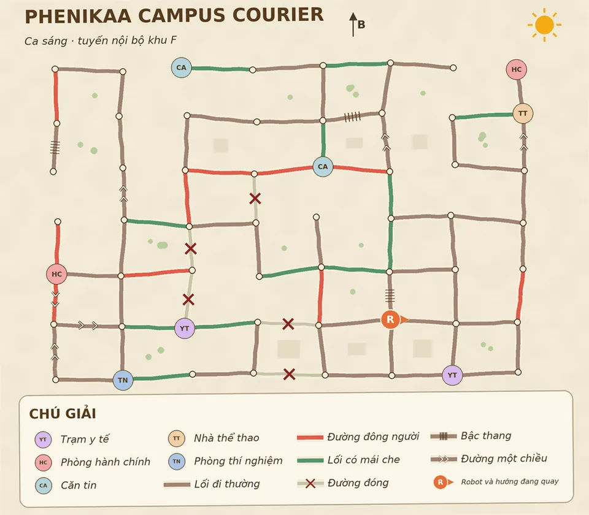

# Multi-Modal Robot Navigation — Vision, Language & Strategy Inference

> **Computer Vision · NLP · Graph Reconstruction · Algorithmic Reverse Engineering**
>
> Hệ thống phân tích bản đồ và yêu cầu tiếng Việt để suy luận chiến thuật di chuyển của robot. Thay vì dự đoán hướng đi trực tiếp từ ảnh, dự án chuyển ảnh thành **đồ thị có cấu trúc**, giải mã nhiệm vụ bằng **BERT**, sau đó áp dụng **thuật toán tìm đường và suy luận chiến thuật**.

## 1. Bài toán

Trong một môi trường giao nhận giả lập, có **10 robot**, mỗi robot có chiến thuật di chuyển riêng. Hệ thống nhận được:

- **Ảnh bản đồ:** các giao lộ, đường thường/đông người/có mái che/đóng, đường một chiều, cầu thang, địa điểm, robot và thời tiết.
- **Câu lệnh tiếng Việt:** đích đến (*goal*), điểm phải ghé trước (*via*), tham chiếu không gian, mức độ khẩn cấp (*urgent*) và hàng dễ vỡ (*fragile*).
- **Robot cần dự đoán:** mã robot hoặc một tập ví dụ di chuyển của robot đó.

Thách thức là **không biết trước toàn bộ hàm chi phí và các quy tắc lựa chọn đường**. Các robot có thể chọn tuyến khác nhau trên cùng một bản đồ; luật còn có thể thay đổi theo thời tiết, hàng hóa và yêu cầu.

Ở **bài toán dự đoán hướng đầu tiên**, đầu ra là `UP`, `DOWN`, `LEFT` hoặc `RIGHT`. Với **biến thể dự đoán toàn tuyến**, hệ thống phải tái dựng và dự đoán chuỗi hướng từ vị trí robot qua `via` (nếu có) tới `goal`.

### Bản đồ minh họa



*Hình minh họa: `minhhoa.jpg`. Đặt ảnh này cùng thư mục với `README.md` để GitHub tự hiển thị.*

Ví dụ, với yêu cầu:

> “Ghé căn tin phía bắc trước, rồi giao hàng tới KTX. Hàng dễ vỡ, đi cẩn thận.”

Hệ thống cần **(1)** đọc đúng vị trí robot, các cạnh và trạng thái đường trên ảnh; **(2)** xác định căn tin *phía bắc* là điểm ghé, KTX là đích và `fragile = true`; **(3)** tính tuyến hợp lệ theo chiến thuật robot. Không được đi đường đóng, đi ngược đường một chiều hoặc bỏ qua điểm ghé bắt buộc.

## 2. Giải pháp của tôi: YOLO → Graph → NLP → RobotFit

```text
                 ẢNH BẢN ĐỒ                         YÊU CẦU TIẾNG VIỆT
                      │                                    │
               YOLOv8m (42 lớp)                      BERT Multi-Head
                      │                                    │
          Bounding boxes + confidence                goal, via, spatial
                      │                               urgent, fragile
             YOLO-to-Graph Parser                          │
                      │                                    │
           ĐỒ THỊ CÓ HƯỚNG G = (V, E) ◄─────────────────────┘
                      │
          RobotFit / Strategy Inference
          Cost Modeling + Search + Tie-breaking
                      │
             HƯỚNG ĐẦU TIÊN / TOÀN TUYẾN
```

**Điểm mạnh của thiết kế:** tách hệ thống thành các bước có thể **đánh giá, phân tích lỗi và tối ưu độc lập**. YOLO đọc ảnh, BERT hiểu nhiệm vụ; thuật toán tìm đường giải thích *vì sao* robot chọn một tuyến, thay vì để một mô hình black-box đoán trực tiếp.

## 3. Computer Vision — Fine-tuning YOLO và khôi phục đồ thị

### 3.1. Nhận diện bản đồ bằng YOLOv8m

- Fine-tune **YOLOv8m** trên bộ ảnh sơ đồ với **38 lớp** ban đầu, gồm: 10 loại địa điểm, 4 hướng robot, các kiểu đường, đường đóng, cầu thang, đường một chiều, thời tiết và các thành phần chú giải.
- Mở rộng thành **42 lớp** bằng bốn lớp `route_up`, `route_down`, `route_left`, `route_right` để đọc thêm tuyến đã đi trong ảnh demo.
- Sinh bounding-box labels từ metadata bản đồ, đồng thời kiểm tra trực quan nhãn trước khi huấn luyện.
- Hạn chế các phép biến đổi hình học làm sai ngữ nghĩa hướng mũi tên/đường một chiều; chú trọng xử lý ảnh mờ, JPEG và sơ đồ nghiêng nhẹ.

### 3.2. Cơ chế YOLO-to-Graph

**YOLO không trực tiếp sinh tuyến đường.** Kết quả detection được giải mã thành **đồ thị có hướng** có thể dùng với Dijkstra và bộ mô phỏng chiến thuật.

1. **Xác định giao lộ:** lấy vị trí các đối tượng được phát hiện, suy ra khoảng cách lưới, gom cụm tọa độ hàng/cột và ánh xạ về nút `(row, col)`.
2. **Khôi phục các cạnh:** ghép bounding box đường vào cặp giao lộ kề nhau, bao gồm xử lý các đoạn thẳng dài và sai lệch tọa độ.
3. **Đọc chú giải động:** ghép `swatch_*` với `txt_normal`, `txt_crowded`, `txt_covered` để hiểu **màu/kiểu nét của chính ảnh hiện tại**. Nhờ vậy, không mặc định “màu xanh = đường có mái che”.
4. **Gán trạng thái và ràng buộc:** mỗi cạnh lưu `status` (`normal`, `crowded`, `covered`, `closed`), cùng các thuộc tính `stairs` và `oneway`. Kết quả phải loại đường đóng và kiểm tra chiều đi hợp lệ.
5. **Gắn thông tin scene:** xác định các landmark, điểm xuất phát, hướng mặt robot và thời tiết.
6. **Khôi phục route từ ảnh demo:** phát hiện các đoạn `route_*`, ghép vào cạnh thực trên đồ thị và nối thành chuỗi di chuyển **bắt đầu từ tọa độ robot**, đi qua `via` nếu có và kết thúc tại `goal`.

**Một cạnh có thể chứa hai lớp thông tin độc lập:**

```text
Cạnh A ── B
  ├── status: crowded       # tính chất đường, từ YOLO + legend
  ├── stairs: false
  ├── oneway: A -> B        # ràng buộc chiều đi
  └── route_status: right   # demo cho biết robot từng đi qua cạnh này
```

`route_status` **không ghi đè** `status` của đường. Điều này giúp vừa hiểu môi trường, vừa học được hành vi robot từ chính tuyến đi mẫu. Các bước route phải khớp với cạnh tồn tại trong graph, không chỉ là các mũi tên nằm gần nhau trên ảnh.

### 3.3. Đánh giá

Ở lần đánh giá bộ đọc bản đồ đã cải tiến, hệ thống đạt **300/300 ảnh validation khôi phục graph chính xác hoàn toàn**; các thống kê precision/recall cạnh được ghi nhận khoảng **99,95%–99,97%**.

> Đây là **kết quả của thành phần YOLO-to-Graph trên tập kiểm định được sử dụng**, không phải độ chính xác dự đoán toàn tuyến hay toàn bộ hệ thống. Phần đọc route 42 lớp và bước ráp route được kiểm thử riêng, không đánh đồng với kết quả graph 38 lớp.

## 4. NLP — Hiểu câu lệnh tiếng Việt bằng BERT

Fine-tune mô hình BERT theo kiến trúc **shared encoder + 8 task-specific heads** để dự đoán:

- `goal`, `via`: đích đến và điểm ghé;
- `gkind`, `ganchor`, `vkind`, `vanchor`: tham chiếu không gian (*bắc/nam/đông/tây/gần/xa* và địa điểm mốc);
- `urgent`, `fragile`: khẩn cấp và dễ vỡ.

Pipeline xử lý các cách gọi địa điểm khác nhau, câu phủ định, yêu cầu không dấu và thứ tự câu linh hoạt. Kết quả NLP sau đó được **ground** vào các địa điểm thật có trên graph, bảo đảm chọn đúng bản sao địa điểm khi bản đồ có hai vị trí cùng loại.

## 5. RobotFit — Suy luận chiến thuật thay vì đoán mò

Mỗi robot có chiến thuật di chuyển riêng. Phần nghiên cứu tập trung vào việc **tái dựng hàm chi phí và quy tắc phá hòa** từ những đường đi được quan sát.

- **Cost modeling:** biểu diễn chi phí đường theo loại cạnh, thời tiết, mức độ khẩn cấp, hàng dễ vỡ, cầu thang và thao tác rẽ.
- **Search & simulation:** dùng Dijkstra trên đồ thị có trạng thái hướng, đồng thời xét các ràng buộc `via`, `oneway`, `closed`, `stairs`; với chiến thuật tham lam, mô phỏng lựa chọn từng bước.
- **Strategy inference:** quét tổ hợp tham số, mô phỏng lại route demo và lọc các cấu hình khớp với hành vi đã quan sát.
- **Tie-breaking:** phân tích riêng những trường hợp nhiều đường có cùng chi phí, tránh ép trọng số để giải thích những lựa chọn vốn do luật phá hòa quyết định.
- **Error analysis:** phân nhóm trường hợp sai theo robot, thời tiết, tình huống nhiệm vụ, loại cạnh, số lần rẽ và cấu trúc tuyến.

Trong notebook pipeline được cung cấp, bộ mô phỏng còn **liệt kê họ cấu hình chiến thuật và đối chiếu với các tuyến demo** trước khi dự đoán các query mới. Cách tiếp cận này có tính diễn giải tốt: có thể truy vết từ hướng robot chọn ngược về trọng số, điều kiện và ràng buộc trên đồ thị.

## 6. Điểm mạnh kỹ thuật

| Thành phần | Điểm nổi bật |
|---|---|
| **Computer Vision** | Fine-tune YOLO trên sơ đồ có nhiều phong cách vẽ, mở rộng từ 38 lên 42 lớp |
| **YOLO-to-Graph** | Chuyển detection thành graph có hướng, giải mã legend động, ràng buộc oneway/stairs/closed |
| **Route Understanding** | Phân biệt loại đường và tuyến demo, khôi phục chuỗi hướng dựa trên cạnh graph thật |
| **NLP** | Multi-task BERT 8 heads, xử lý tiếng Việt, phủ định và tham chiếu không gian |
| **Algorithmic AI** | Dijkstra, Greedy, tham số chi phí theo ngữ cảnh, search và luật phá hòa |
| **Research Workflow** | Phân tích lỗi từng tầng, kiểm định riêng từng thành phần, mô phỏng và so sánh giả thuyết |

## 7. Công nghệ

**Python · PyTorch · Ultralytics YOLOv8m · Hugging Face Transformers · BERT · OpenCV · NumPy · Graph Algorithms · Dijkstra · Beam Search · Jupyter/Google Colab**

---

**Tóm lại:** Giá trị cốt lõi của dự án là kết hợp **Deep Learning để đọc và hiểu dữ liệu phi cấu trúc** với **Graph Algorithms và Reverse Engineering để đưa ra quyết định có thể giải thích**. Đây là bài toán AI đa mô-đun, trong đó độ chính xác của từng khâu ảnh hưởng trực tiếp đến kết quả cuối.
